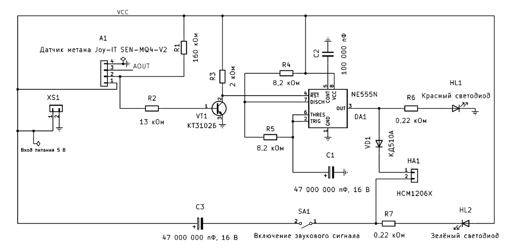

  

  <strong>Курсовой проект МАИ</strong> 
  Учебный сигнализатор утечки метана (CH₄)

# Курсовой проект: сигнализатор утечки метана

**Рабочая ветка:** `analysis/vendor-behavioral-reconciliation`  
**Текущая конструктивная база:** локальная реализация E3, опубликованная в GitHub.  
**Статус:** проектная CAD-разработка и комплект РПЗ/КД в работе. ERC/DRC выполнены по подтверждению пользователя. Изделие не является сертифицированным средством защиты.

## Основные документы

- [Техническое задание (проект)](requirements/technical_assignment_draft.md)
- [Технические условия (проект)](requirements/technical_conditions_draft.md)
- [Матрица требований и проверок](requirements/verification_matrix.md)
- [Расчётно-пояснительная записка](docs/rpz/README.md)
- [Состав комплекта ЕСКД](docs/eskd_and_course_document_set.md)
- [Реестр документов и чертежей](docs/document_register.md)
- [Перечень элементов ПЭ3](docs/preliminary_element_list_PЭ3.md)
- [Правила заполнения основной надписи](docs/title_block_fill_guide.md)

## Текущий проект E3

Актуальные CAD-файлы:
- `cad/kicad/e3_project/gazo_e3_implementation.kicad_sch`
- `cad/kicad/e3_project/gazo_e3_implementation.kicad_pcb`
- `cad/kicad/e3_project/gazo_e3_implementation.kicad_pro`
- `cad/kicad/e3_project/fp-lib-table`
- библиотека применяемых footprints: `cad/kicad/footprints/GazoE3.pretty/`

Параметры PCB из файла: 59×45 мм, два медных слоя, FR-4 1,6 мм, 4 отверстия NPTH Ø2,2 мм с межосевыми расстояниями 52×37 мм, 19 функциональных компонентов, 206 сегментов трассировки, 21 via и 5 зон меди. Source-level сверка карты 47 pad-to-net с площадками PCB дала 47 совпадений. Пользователь подтвердил выполнение ERC/DRC и корректность ориентации A1/XS1 и полярности HA1/C1/C3. Повторные проверки не требуются в текущем цикле.

  

*Иллюстрация принципиальной схемы E3. Редактируемый источник схемы находится в `cad/kicad/e3_project/gazo_e3_implementation.kicad_sch`.*

## Формат чертежей

A3 используется как рабочий CAD-мастер, чтобы не ухудшать читаемость при разработке. Итоговый комплект графических документов планируется выдавать на A4 путём контролируемого уменьшения/переразмещения. После преобразования обязательно проверить текст, обозначения, линии, размеры, основную надпись и масштаб. Исходники A3 сохраняются.

## РПЗ и пример конструкторской документации

- Контрольная ODT-сборка РПЗ: [OneDrive](https://1drv.ms/w/c/24fda6920aa8c92a/IQBgvF5tTSGsRpjx8u47tfMPAWUgI9pUcU).
- Пример состава и оформления СБ/ВО, а также выбор ПО: [пример СБ и ВО](docs/examples/sb_vo_drawing_example.md).
- СБ/ВО рекомендуется выпускать в FreeCAD TechDraw по 3D-сборке. KiCad использовать для Э3 и ПП.

## Что уже сделано

- Создана и опубликована локальная реализация схемы и двухслойной PCB E3.
- В проект подключена собственная библиотека GazoE3 для SA1 и VT1.
- Подготовлена карта 47 назначений площадок к электрическим сетям.
- Подготовлены 11 глав рабочей РПЗ и расчётные материалы по питанию, теплу, надёжности и массогабаритам.
- Сформирован проектный перечень элементов ПЭ3 и перечень КД.
- Сформирована нормативная основа по ЕСКД, ТЗ и ТУ.

## Что осталось

- Разработать отдельную плату питания E4 с учётом расчётной нагрузки около 0,402 А и предварительного F1 T630 mA.
- Завершить почти готовую модель корпуса.
- Выпустить СБ и ВО в FreeCAD TechDraw на базе 3D-сборки по [примеру оформления](docs/examples/sb_vo_drawing_example.md). Для чертежа ПП использовать KiCad.
- Подготовить спецификацию по фактической PCB/BOM и составу сборки.
- Получить актуальную ODT-редакцию РПЗ из [OneDrive](https://1drv.ms/w/c/24fda6920aa8c92a/IQBgvF5tTSGsRpjx8u47tfMPAWUgI9pUcU) и синхронизировать с проектом.
- A4-выдачу отложить на следующий этап.

Физическое изготовление, лабораторная проверка, калибровка порога и сертификация не заявляются как выполненные.
