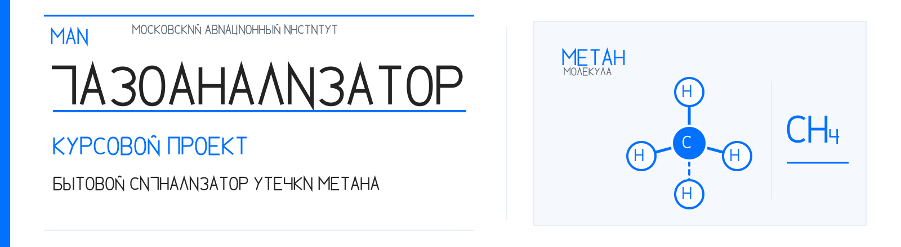
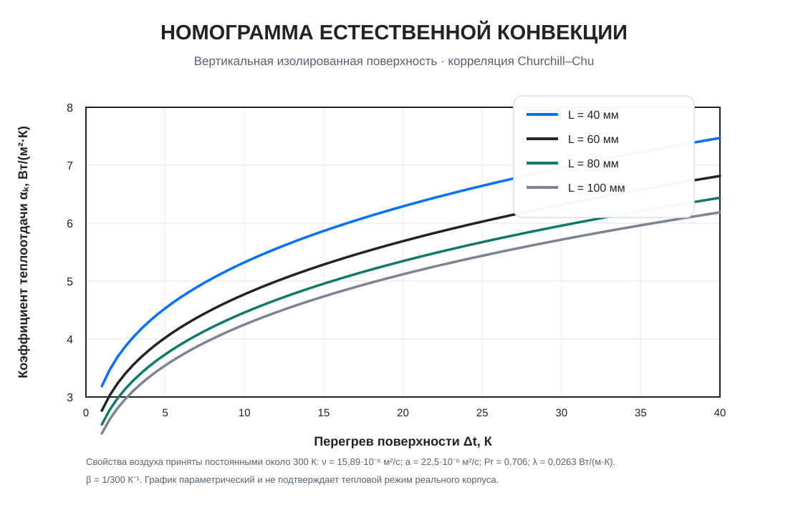

  

  <strong>Курсовой проект МАИ</strong> 
  Бытовой сигнализатор утечки метана (CH₄)

  
  
  
  
  

---

## О проекте

Проект объединяет электрическую схему, выбор элементной базы, электрические и тепловые расчёты, разработку печатных плат и корпуса, а также расчётно-пояснительную записку. Документация ведётся как инженерный комплект с прослеживаемыми исходными данными, ограничениями моделей и статусами проверок.

  

Фактический сенсорный модуль A1. Изображение не является фотографией готового сигнализатора.

## Быстрый доступ

| Для чего | Документ |
|---|---|
| Начать знакомство и проверить проект | [Маршрут для преподавателя и рецензента](docs/REVIEW_GUIDE.md) |
| Посмотреть состояние работ | [Карта прогресса](docs/project_progress_map.md) · [визуальная карта SVG](docs/project_progress_map.svg) |
| Изучить расчётно-пояснительную записку | [Структура и материалы РПЗ](docs/rpz/README.md) |
| Открыть стандарт оформления документации | [Documentation Style Guide](docs/DOCUMENTATION_STYLE.md) |
| Посмотреть графики и иллюстрации | [Каталог изображений](docs/figures/README.md) |
| Проверить состав документации | [Реестр документов](docs/document_register.md) |
| Изучить исходные требования | [Техническое задание](requirements/technical_assignment_draft.md) · [матрица верификации](requirements/verification_matrix.md) |
| Проверить компонентную базу | [Реестр MPN и footprints](cad/footprint_selection_2026-11-01.md) · [документальный аудит E3/E4](cad/footprint_audit_2026-11-02.md) |
| Найти нормативную базу и правила РПЗ | [Методики МАИ](docs/course_acceptance/README.md) · [контрольный лист оформления](requirements/report_formatting.md) |
| Проследить историю решений | [Инженерный журнал](docs/engineering_log_2026-11-02.md) · [индекс архива](docs/ARCHIVE_INDEX.md) |

## Зафиксированная конфигурация

| Узел | Текущее решение |
|---|---|
| Сенсорный модуль A1 | Joy-IT SEN-MQ4-V2 |
| Основная схема E3 | Утверждённая редакция, зафиксированная тегом gost-e3-approved-2026-11-01 |
| Таймер DA1 | NE555N по утверждённой схеме. Для первой итерации PCB выбран физический кандидат TI NE555P |
| Транзистор VT1 | КТ3102Б |
| Звуковой излучатель HA1 | Ningbo Kepo HCM1206X, чертёж OEM2690R |
| Питание | Отдельная плата USB-C E4. На основную плату подаётся +5 В через XS1 |
| Условия среды | +10…+35 °C, относительная влажность 20–80 % без конденсации. Это проектное условие, совместимость полной BOM ещё проверяется |

## Состояние разработки

| Направление | Статус | Текущее положение |
|---|---|---|
| Схема E3 | **APPROVED** | Базовая редакция зафиксирована тегом gost-e3-approved-2026-11-01 |
| ERC и XML-netlist E3 | **VERIFIED** | 0 ошибок ERC и 18 предупреждений в сохранённом отчёте |
| MPN и footprints | **PRELIMINARY** | Выполнен документальный аудит 19 позиций E3 и кандидатов E4. Открыты drawing-derived VT1, pin maps A1/HA1 и KiCad footprint checks |
| PCB E3 | **NOT STARTED** | Подготовлены netlist и план размещения. Трассированная плата ещё не создана |
| USB-C E4 | **PREPARATION** | Архитектура определена. Схема, PCB и защита VBUS ещё не завершены |
| Токовый бюджет | **BLOCKED** | Паспорт не задаёт полный максимальный ток A1. Worst-case всей системы пока не доказан |
| Тепловой расчёт | **PRELIMINARY** | Оценены отдельные источники тепла. Полной модели конечной сборки пока нет |
| Механика и корпус | **NOT STARTED** | Интегрированный корпус E3/E4 ещё не создан |
| Надёжность | **PRELIMINARY** | Количественная оценка ожидает точной BOM и условий эксплуатации |
| РПЗ | **IN PROGRESS** | Содержательные главы подготовлены. Требуются техническая и редакционная проверки |

## Расчётные материалы и графики

Ниже приведены действующие параметрические графики теплового раздела. Они показывают чувствительность расчётной модели и не являются результатами измерения готового корпуса.

  

Подробная методика, исходные допущения и ограничения приведены в [разделе 6 РПЗ](docs/rpz/06_thermal_model_and_sensitivity.md).

## Статусы и границы достоверности

- **APPROVED** — решение утверждено или базовая редакция зафиксирована. Это не означает аппаратные испытания.
- **VERIFIED** — проверено только в явно указанном объёме, например ERC, netlist или отдельная геометрия.
- **PRELIMINARY** — предварительный расчёт, проектный кандидат или компоновка.
- **BLOCKED** — отсутствуют необходимые исходные данные или проверка не может быть подтверждена в пределах текущего CAD-only проекта.
- **HISTORICAL** — материал сохранён для прослеживаемости, но не относится к текущей реализации.

Проект не является производственно выпущенным или сертифицированным газосигнализатором. SPICE-расчёты, ERC и CAD-проверки не заменяют измерения на физическом макете и калибровку сенсорного канала. Физическое изготовление, закупка и лабораторные измерения не входят в текущий подтверждённый объём. Неподтверждённые без образца характеристики сохраняют статус TBC.

## Рабочая ветка и сохранение базовой схемы

Основная рабочая ветка: analysis/vendor-behavioral-reconciliation. Изменения, проверки и контрольные точки фиксируются коммитами и инженерным журналом. Утверждённая схема E3, её отчёты и тег gost-e3-approved-2026-11-01 не изменяются в рамках редакционного оформления документации.

## Структура репозитория

- cad/ — схемы, проекты PCB, посадочные места, компоновка, корпус и отчёты CAD.
- calculations/ — ручные расчёты и проверки с явным разделением актуальных и исторических материалов.
- data/ — исходные данные, характеристики компонентов и реестр источников.
- docs/ — навигация, инженерные журналы, методики, изображения и РПЗ.
- requirements/ — проектные требования и контрольные матрицы.
- spice/ — модели, тестбенчи и воспроизводимые SPICE-сценарии.

Политика работы с историческими материалами описана в [индексе архива](docs/ARCHIVE_INDEX.md).
