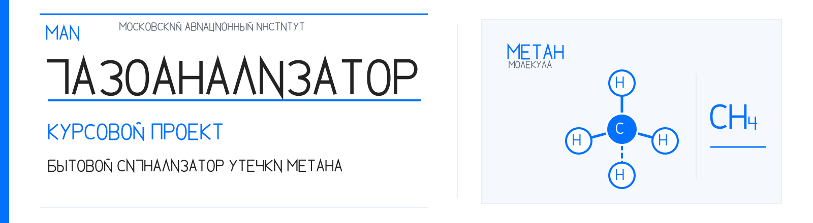

# Навигация по проекту

  

  
  
  

> Документы ниже расположены в порядке инженерной проверки: от исходных требований и утверждённой схемы к расчётам, конструкции и итоговой документации. Текущий статус каждого этапа нужно читать вместе с его ограничениями.

## Кратко об изделии

  

Изображён только сенсорный модуль A1, не готовое изделие.

**Изделие:** бытовой сигнализатор утечки метана (CH₄).  
**Электрическая база:** утверждённая принципиальная схема Э3 с Joy-IT SEN-MQ4-V2.  
**Питание:** отдельная плата USB-C E4, выдающая +5 В на основную плату.  
**Условия окружающей среды:** +10…+35 °C, относительная влажность 20–80 % без конденсации. Это утверждённые проектные условия, а не подтверждение климатической стойкости готовой сборки.  
**Состояние:** электрическая схема E3 зафиксирована. PCB E3/E4, интегрированный корпус и испытания готового изделия не завершены.

## Маршрут проверки

| № | Что проверить | Основной документ |
|---:|---|---|
| 1 | Статус и план проекта | [Карта прогресса](project_progress_map.md), [визуальная карта](project_progress_map.svg) |
| 2 | Назначение, требования и условия среды | [Исходные данные](../data/initial_data.md), [проектные требования](../requirements/technical_assignment_draft.md), [матрица верификации](../requirements/verification_matrix.md) |
| 3 | Утверждённая принципиальная схема Э3 | [KiCad-схема](../cad/project_modification/gost_e3_final/gazo_analizator_E3_GOST_itog.kicad_sch), [паспорт утверждённой редакции](../cad/project_modification/gost_e3_final/APPROVED_BASELINE.md) |
| 4 | Электрическая связность и проверки схемы | [XML-netlist](../cad/project_modification/gost_e3_final/reports/kicad10/netlist_current.xml), [карта pad-to-net](../cad/project_modification/gost_e3_final/reports/kicad10/e3_pad_net_map.csv), [ERC](../cad/project_modification/gost_e3_final/reports/kicad10/erc_current.rpt) |
| 5 | Выбор физических компонентов | [Реестр MPN и footprints](../cad/footprint_selection_2026-11-01.md) |
| 6 | Размещение и проектирование основной платы | [План E3](../cad/placement_plan_joyit_e3_2026-11-01.md), [зоны размещения](../cad/placement/e3_placement_plan.md) |
| 7 | Питание USB-C | [Архитектура платы E4](../cad/power_input_usb/README.md) |
| 8 | Электрические и тепловые оценки | [Токовый бюджет E3](../calculations/power_budget_joyit_e3.md), [тепловые ограничения](../calculations/thermal_joyit_e3.md) |
| 9 | Полная расчётно-конструкторская проработка | [Комплект РПЗ](rpz/README.md) |
| 10 | Исторические и альтернативные материалы | [Индекс архива](ARCHIVE_INDEX.md) |

## Основные инженерные результаты

### Электрическая схема Э3

Утверждённая редакция Э3 хранится в каталоге cad/project_modification/gost_e3_final/. Схема и её XML-netlist зафиксированы тегом gost-e3-approved-2026-11-01.

В сохранённом отчёте KiCad ERC указано 0 ошибок и 18 предупреждений. 17 предупреждений связаны с отсутствующими фильтрами посадочных мест в символах схемы, одно — с отдельной сетью AOUT. Это подтверждает только проверку CAD-документа в указанном объёме, но не физическую плату и не работоспособность собранного устройства.

### Элементная база

В [реестре физических компонентов](../cad/footprint_selection_2026-11-01.md) указаны кандидаты MPN, корпуса и footprints. Для КТ3102Б footprint пока намеренно не назначен до проверки физического образца. Пользовательские footprints HCM1206X и NKK AS11AP требуют проверки в KiCad 10 и сопоставления с реальными деталями.

### Электрические ограничения

- Полярность и нагрузочная способность DOUT модуля SEN-MQ4-V2 должны быть подтверждены по фактической ревизии.
- Предварительная сумма известных внешних нагрузок составляет около 77,6 мА. Ток A1 не включён, поскольку доступный паспорт не задаёт гарантированный полный ток модуля.
- Токовый бюджет не закрыт до измерения холодного старта, прогрева, установившегося режима и тревоги.
- Расчётный период NE555 по номиналам Э3 составляет около 0,801 с. Проверка частоты на физической плате не выполнялась.

### Печатные платы и корпус

Согласно карте прогресса, PCB E3 и E4 ещё не созданы как завершённые трассированные платы. Для E3 подготовлены эталон netlist, список компонентов и план размещения. Для E4 определена архитектура USB-C sink, но схема, защита VBUS и PCB ещё требуют разработки. Интегрированный корпус должен создаваться после фиксации физических габаритов и компоновки обеих плат.

## Условия окружающей среды

Утверждены проектные условия:
- температура окружающей среды +10…+35 °C;
- относительная влажность 20–80 % без конденсации.

Эти требования используются для последующей проверки компонентной базы и конструкции. Они не означают, что тепловой режим внутри корпуса уже рассчитан, а климатическая стойкость изделия испытана. Совместимость всех окончательных MPN с этими условиями требуется документально подтвердить.

## Статусы документации

- **APPROVED** — решение утверждено или базовая редакция зафиксирована. Это не означает аппаратные испытания.
- **VERIFIED** — проверено в прямо указанном объёме, например ERC, netlist или отдельная геометрия.
- **PRELIMINARY** — предварительный расчёт, проектный кандидат или компоновка.
- **BLOCKED** — не хватает исходных данных или физической проверки.
- **NOT STARTED** — работа ещё не выполнена.
- **HISTORICAL** — материал сохранён для прослеживаемости и не относится к текущей реализации.

## Визуальные и редакционные материалы

- [Каталог иллюстраций и графиков](figures/README.md).
- [Стандарт оформления Markdown, формул LaTeX и изображений](DOCUMENTATION_STYLE.md).
- [Правила оформления РПЗ](../requirements/report_formatting.md).

## Полезные указатели

- [Карта прогресса проекта](project_progress_map.md).
- [Реестр документов](document_register.md).
- [Методическая база МАИ](course_acceptance/README.md).
- [Нормативные требования к РПЗ](../requirements/report_formatting.md).
- [Реестр исторических и альтернативных материалов](ARCHIVE_INDEX.md).
- [Политика рабочей ветки](branch_policy.md).

## Границы результатов

В репозитории хранятся схемные, расчётные и конструкторские документы. Наличие расчёта или CAD-файла не означает, что устройство изготовлено, откалибровано или сертифицировано. Текущая работа формирует учебную проектную документацию. Она не заменяет сертифицированную систему газовой безопасности.
