# Каталог инженерных схем, графиков и иллюстраций

В каталоге разделены материалы утверждённой E3, расчётные визуализации, предварительные конструктивные эскизы и историческая графика. Статус указан перед каждым набором. Иллюстрации не заменяют нативные CAD-файлы, исходные данные расчёта или протокол проверки.

## Теги материалов

Подробное значение меток приведено в [реестре тегов и статусов](../PROJECT_TAGS.md).

## 1. Утверждённая электрическая схема E3

  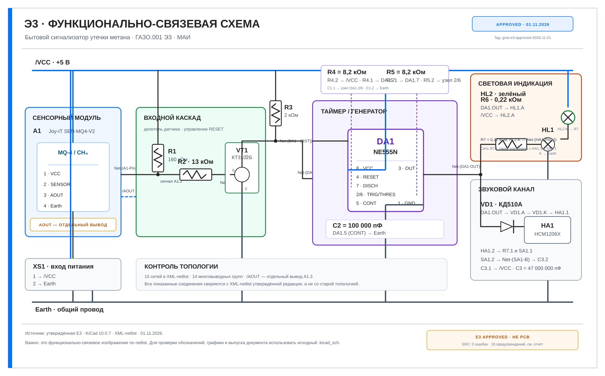

**Рисунок F.1 — Функционально-связевое представление утверждённой E3 по XML-netlist.**

Это дополнительная визуализация топологии. Она не воспроизводит координаты символов, трассировку проводников и основную надпись нативного листа KiCad. Для инженерной проверки используйте:
- [Нативную схему KiCad E3](../../cad/project_modification/gost_e3_final/gazo_analizator_E3_GOST_itog.kicad_sch).
- [Полную карту 15 сетей и выводов](e3_approved_netlist_map.md).
- [XML-netlist](../../cad/project_modification/gost_e3_final/reports/kicad10/netlist_current.xml).
- [Паспорт утверждённой редакции](../../cad/project_modification/gost_e3_final/APPROVED_BASELINE.md).
- [Сохранённый ERC-отчёт](../../cad/project_modification/gost_e3_final/reports/kicad10/erc_current.rpt).
- [Git tag утверждённой E3](https://github.com/valuncilh/gazo_analizator/tree/gost-e3-approved-2026-11-01).

В качестве отдельного изображения фактического компонента используется сенсорный модуль A1:

  

**Рисунок F.2 — Сенсорный модуль Joy-IT SEN-MQ4-V2.** Это фотография модуля, а не готового сигнализатора.

## 2. Действующие расчётные графики

Ниже приведены визуализации главы 6 РПЗ. Обе диаграммы построены из явно указанных расчётных моделей и не являются измерениями готового корпуса.

  
  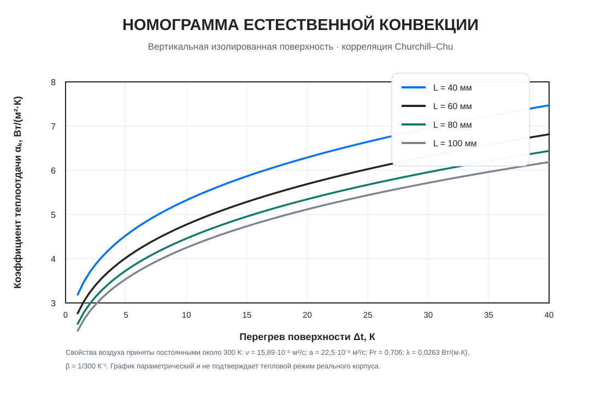

**Рисунок F.3 — Параметрическая тепловая характеристика.**  
**Рисунок F.4 — Номограмма естественной конвективной теплоотдачи вертикальной поверхности.**

Методика и ограничения:
- [Раздел 6 РПЗ](../rpz/06_thermal_model_and_sensitivity.md).
- [Генератор тепловой чувствительности](../rpz/tools/thermal_sensitivity.py).
- [Генератор номограммы Churchill–Chu](../rpz/tools/natural_convection_nomogram.py).

## 3. Графики SPICE-моделей

Эти графики построены по сохранённым логам ngspice из исследовательских сценариев. Они показывают чувствительность математических моделей и не подтверждают реальную распиновку, полярность или выходные параметры конкретного экземпляра SEN-MQ4-V2.

  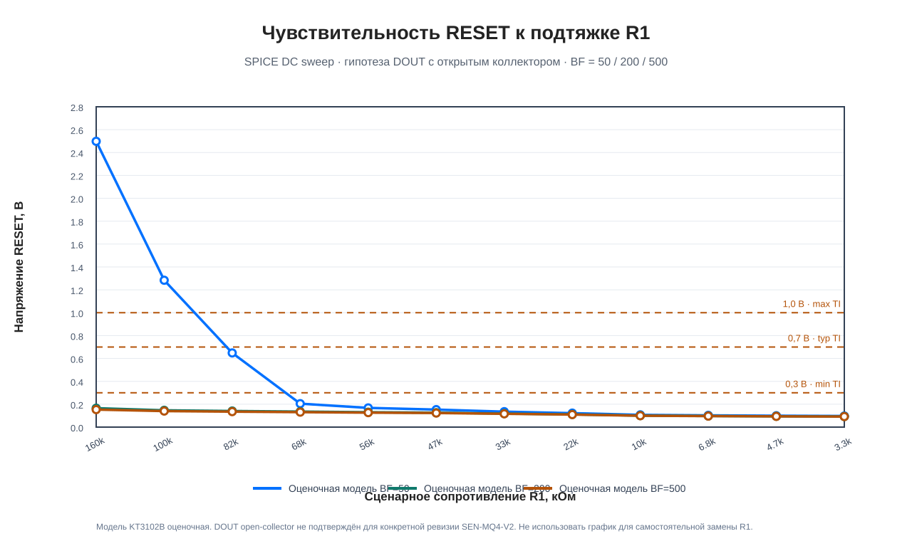
  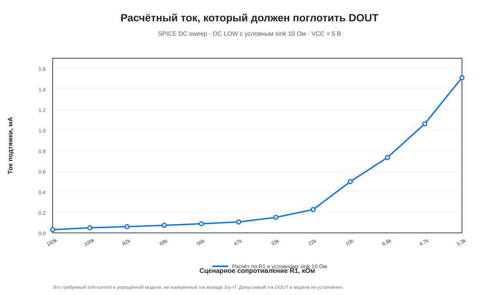

**Рисунок F.5 — Чувствительность RESET к R1.**  
**Рисунок F.6 — Требуемый sink-current выхода DOUT в сценарии OC LOW.**

  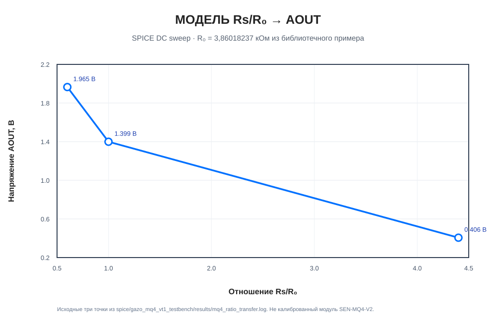

**Рисунок F.7 — Исследовательская модель Rs/R0 → AOUT.**

Подробности, входные логи и ограничения приведены в [каталоге SPICE-графиков](../../spice/graphs/README.md). Сценарии относятся к упрощённым моделям, а не к утверждённому физическому модулю.

## 4. Предварительная компоновка E3

  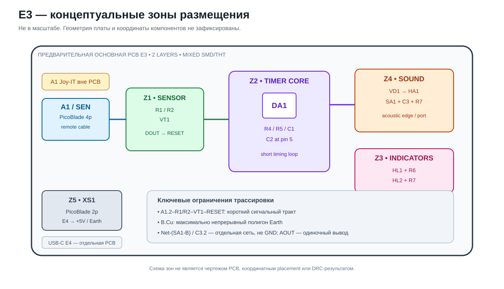

**Рисунок F.8 — Концептуальные зоны размещения E3.** Геометрия платы и координаты компонентов не зафиксированы. Это не PCB, не placement freeze и не результат DRC.

## 5. Предварительные конструктивные эскизы

Файлы ниже хранятся для обсуждения конструктивной последовательности. Геометрия платы 72×50 мм и ранняя оболочка корпуса 120×78×42 мм не являются утверждёнными размерами текущей сборки. Электрическая топология в отдельном эскизе отражает раннюю архитектуру MQ-4/U2/VT2, а не утверждённую E3.

Открыть предварительные конструктивные листы

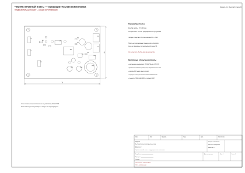

**Рисунок F.9 — Предварительный план расположения компонентов PCB.** Не использовать для изготовления.

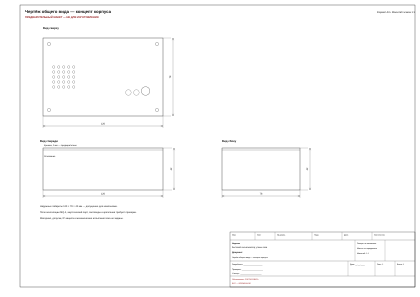

**Рисунок F.10 — Предварительный внешний вид корпуса.** Размеры и посадочные места требуют переработки.

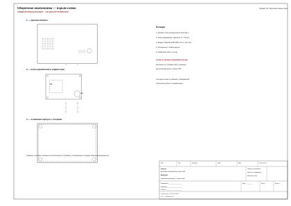

**Рисунок F.11 — Предварительная взрыв-схема компоновки.** Не является утверждённым сборочным чертежом.

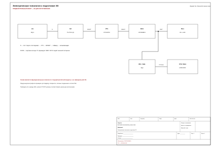

**Рисунок F.12 — Историческая топология к подготовке Э3.** Содержит старые U2/TLV7041-Q1, КТ3102ГМ и КР1006ВИ1. Не соответствует утверждённой E3.

## 6. Историческая графика

Исторические материалы сохраняются для прослеживаемости разработки. Они не описывают утверждённую текущую E3.

Исторические схемы и экспортные изображения

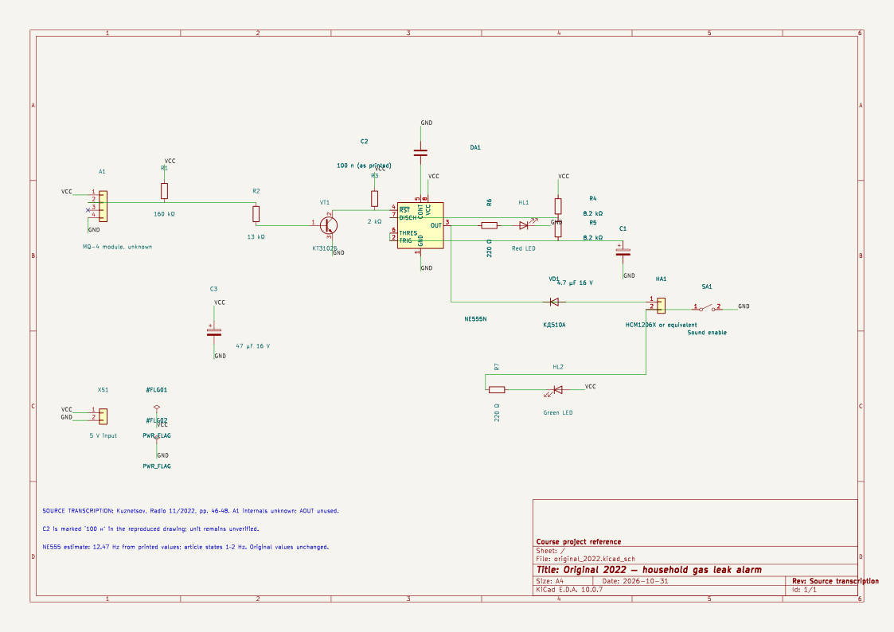

**Рисунок F.13 — Исходная схема 2022 года.**

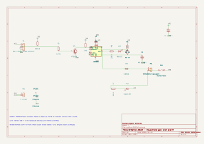

**Рисунок F.14 — Векторный экспорт исходной схемы 2022 года.**

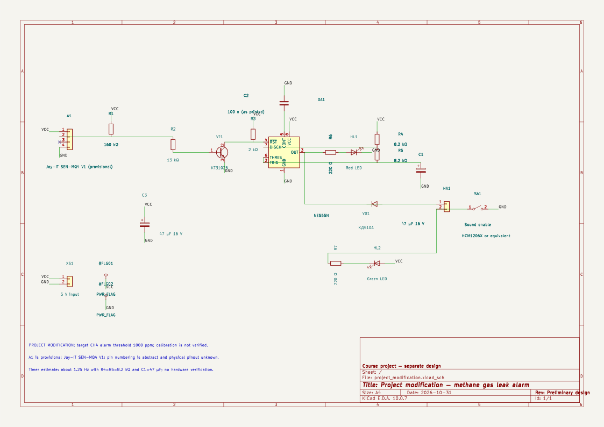

**Рисунок F.15 — Ранний вариант проектной схемы.** Не является утверждённой E3.

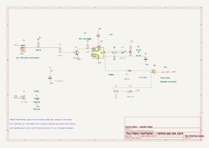

**Рисунок F.16 — Векторный экспорт ранней проектной модификации.** Не использовать для описания текущей схемы.

Архивные графики ранней архитектуры MQ-4 (9 изображений)

> Все девять PNG ниже относятся к раннему анализу архитектуры MQ-4 с аналоговым выходом, внешним компаратором U2 и нагрузочной ветвью VT2. Они не являются иллюстрациями утверждённой E3 с Joy-IT SEN-MQ4-V2.

### Исходная схема и функциональная архитектура

**Исторический рисунок F.17** — схема из публикации С. Кузнецова, «Радио», 2022, № 11, с. 46–48.

**Исторический рисунок F.18** — ранняя функциональная архитектура с аналоговым сенсорным сигналом и компаратором.

### Сенсорная и компараторная модели

**Исторический рисунок F.19** — модель MQ-4 через Rs/RL.

**Исторический рисунок F.20** — подмодель U2 = TLV7041-Q1.

### Таймер, звуковая нагрузка и SPICE

**Исторический рисунок F.21** — сравнение периодов таймера в ранней ветке.

**Исторический рисунок F.22** — модель TLC555 как функционального аналога КР1006ВИ1.

**Исторический рисунок F.23** — ранняя нагрузочная ветвь VT2/R9.

**Исторический рисунок F.24** — переходные процессы старой vendor-модели TLV7041/TLC555.

**Исторический рисунок F.25** — линеаризованные подмодели. Это не экспериментальная АЧХ сенсора.

## 7. Правила происхождения и обновления

- SVG схем и графиков хранить вместе с исходными netlist или скриптами генерации.
- Для SPICE-графика указывать ngspice-лог, тестбенч, модель и сценарные допущения.
- Для каждой PRELIMINARY-иллюстрации указывать, какие размеры, координаты или MPN ещё не подтверждены.
- Не использовать HISTORICAL-материалы как источник электрических соединений утверждённой E3.
- Не удалять исторические PNG/SVG: они сохраняют прослеживаемость ранней разработки.
