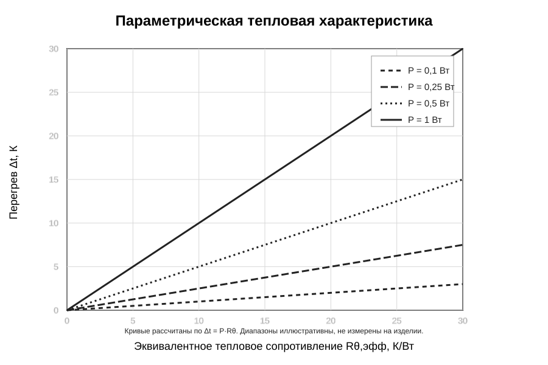
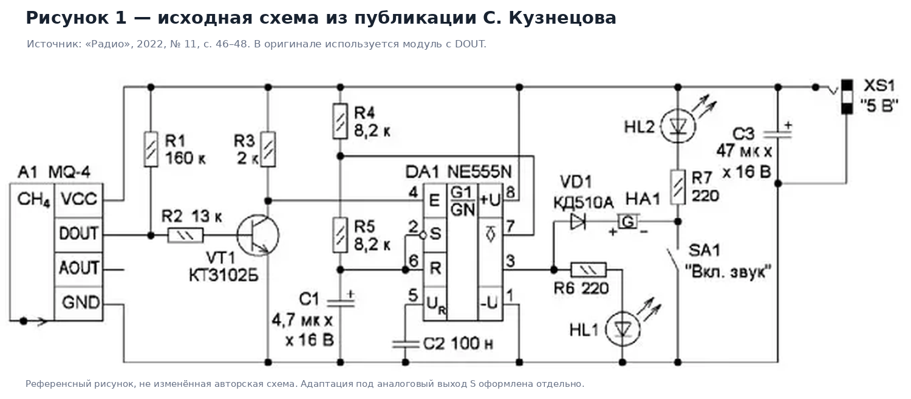
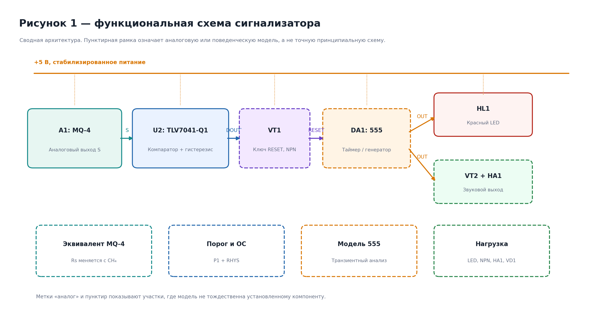
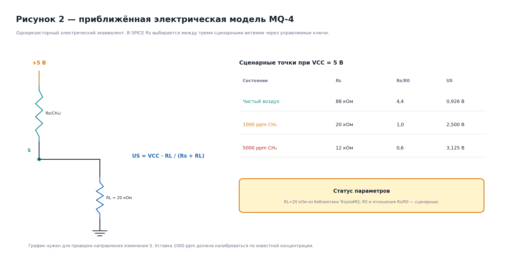
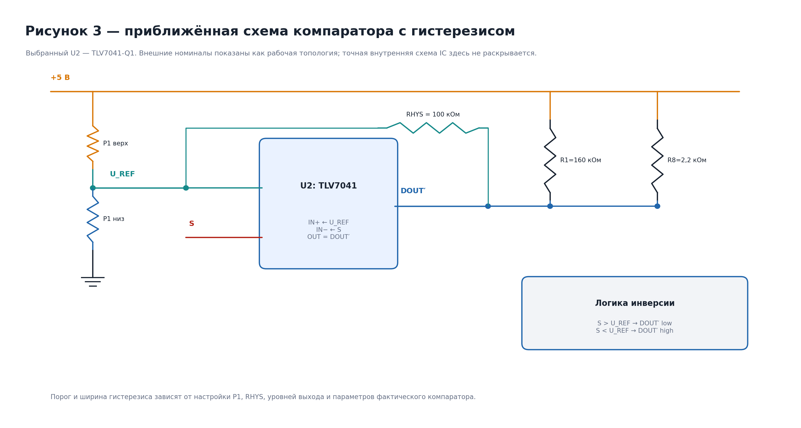
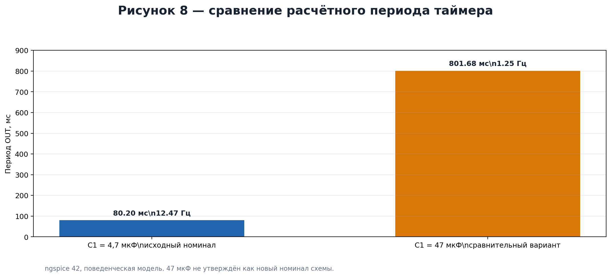
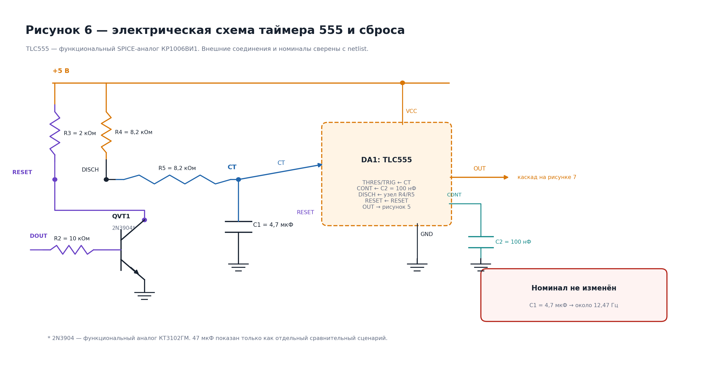
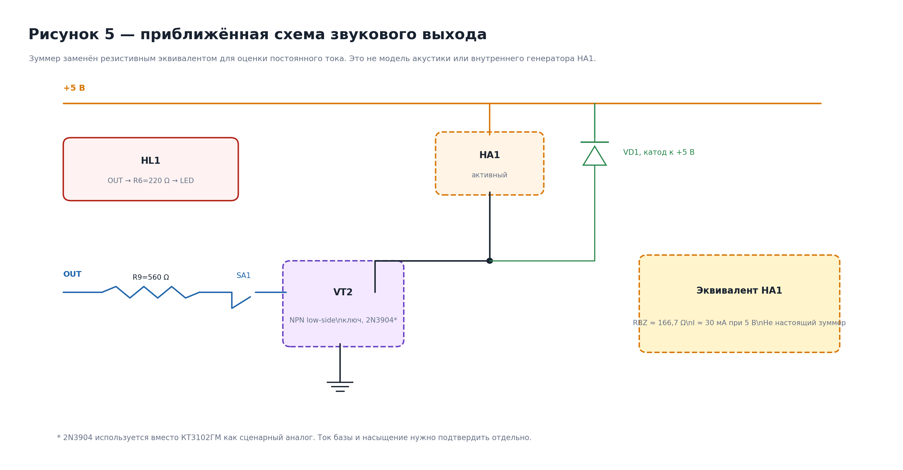
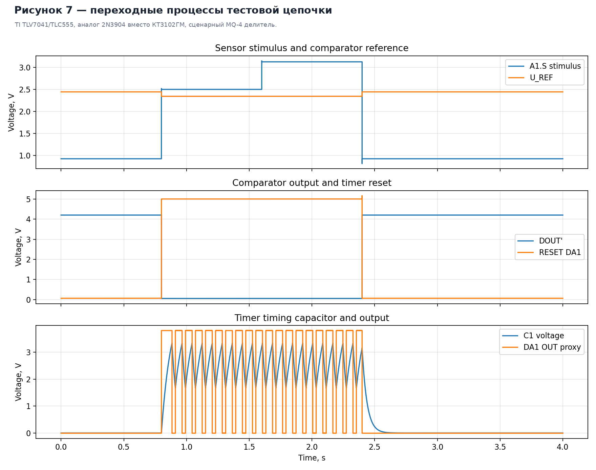
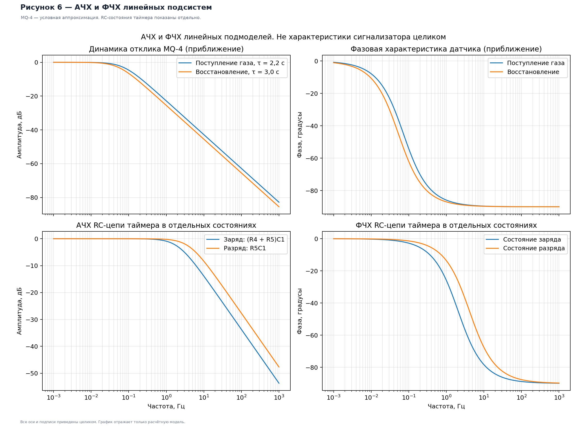

# Иллюстрации и расчётные схемы

Каталог объединяет актуальные изображения физических компонентов и исторические графические материалы ранних вариантов схемы. Статус каждой иллюстрации указан явно.

## Материалы текущей проектной базы

  

Рисунок F.1 — Сенсорный модуль A1 Joy-IT SEN-MQ4-V2. Это фотография отдельного модуля, а не готового сигнализатора.

Параметрические тепловые диаграммы актуального расчётного раздела:

  
  

Обе диаграммы являются расчётными иллюстрациями. Они не подтверждают температуру готового корпуса и не заменяют тепловые измерения.

Актуальные проектные документы:
- [Утверждённая принципиальная схема E3](../../cad/project_modification/gost_e3_final/gazo_analizator_E3_GOST_itog.kicad_sch).
- [Паспорт базовой редакции E3](../../cad/project_modification/gost_e3_final/APPROVED_BASELINE.md).
- [Маршрут проверки проекта](../REVIEW_GUIDE.md).
- [Стандарт оформления Markdown, формул и изображений](../DOCUMENTATION_STYLE.md).
- [Индекс исторических материалов](../ARCHIVE_INDEX.md).

## Историческая галерея

> [!WARNING]
> Все девять PNG ниже относятся к раннему анализу архитектуры MQ-4 с аналоговым выходом, внешним компаратором U2 и нагрузочной ветвью VT2. Они **не являются иллюстрациями утверждённой E3** с Joy-IT SEN-MQ4-V2. Не использовать их для описания соединений, расчётов или состава текущей схемы.

Открыть историческую галерею (9 изображений)

### Исходная схема и функциональная архитектура

**Исторический рисунок F.2** — схема из публикации С. Кузнецова, «Радио», 2022, № 11, с. 46–48. Источник идеи, не текущая E3.

**Исторический рисунок F.3** — функциональная схема ранней архитектуры с аналоговым сенсорным сигналом и компаратором.

### Сенсорная и компараторная модели

**Исторический рисунок F.4** — модель MQ-4 через Rs/RL. Сценарные значения не являются калибровкой реального модуля.

**Исторический рисунок F.5** — подмодель U2 = TLV7041-Q1 с фиксированным делителем и обратной связью. Не является текущей E3.

### Таймер и звуковая нагрузка

**Исторический рисунок F.6** — сравнение периодов для C1 = 4,7 мкФ и 47 мкФ в ранней расчётной ветке.

**Исторический рисунок F.7** — модель TLC555 как функционального аналога КР1006ВИ1. Не считать идентичной заменой.

**Исторический рисунок F.8** — нагрузочная ветвь с VT2/R9 и DC-эквивалентом излучателя. Не описывает звуковой канал утверждённой E3.

### Результаты SPICE-моделирования

**Исторический рисунок F.9** — переходные процессы старой vendor-модели TLV7041/TLC555. Это симуляция, а не измерение устройства.

**Исторический рисунок F.10** — линеаризованные модели с условными постоянными времени. Это не экспериментальная АЧХ сенсора.

## Происхождение и обновление изображений

PNG-файлы исторической галереи создаются скриптом generate_figures.py на основе исходных данных и результатов SPICE-моделирования прежней архитектуры. Для повторной генерации из корня репозитория:

    python3 docs/figures/generate_figures.py

Перед запуском требуется проверить, что тестбенчи и выходные данные соответствуют нужной исторической ветке. Генерация изображений сама по себе не обновляет их инженерный статус.

## Ограничения использования

1. Не вставлять исторические рисунки F.2–F.10 в описание текущей E3 как её принципиальную или функциональную схему.
2. Не использовать модель TLV7041, VT2/R9 или Amperka AMP-B052 для расчётов утверждённой схемы без отдельного пересчёта.
3. Любой SPICE-график сопровождать названием netlist, параметрами модели, условиями запуска и явным указанием, что результат является симуляцией.
4. Для текущего проекта использовать утверждённый E3 KiCad-файл и актуальные расчёты Joy-IT E3. Новые иллюстрации текущей архитектуры создавать после проверки их соответствия XML-netlist.
5. Не удалять исторические PNG и генератор: они сохраняют прослеживаемость раннего исследования.
