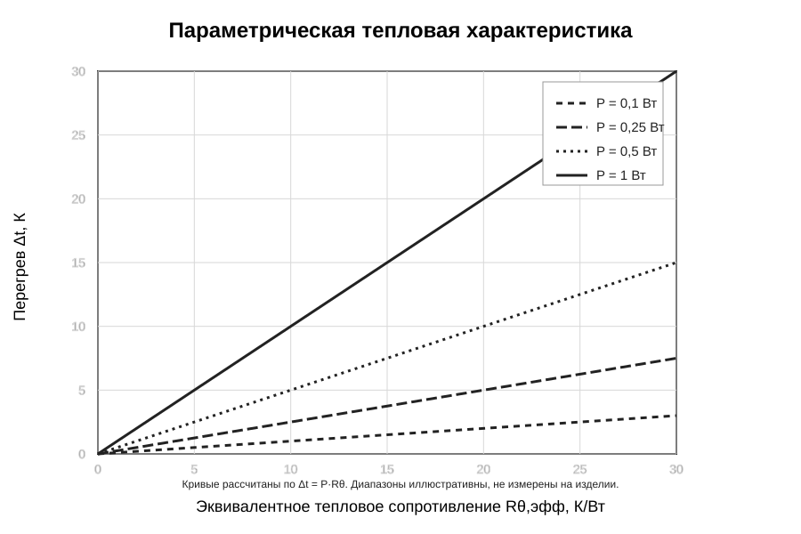

# 6 Тепловой режим и охлаждение

**Статус раздела:** параметрическая тепловая оценка. Итоговая температура корпуса и компонентов не вычисляется до фиксации сенсорного модуля, корпуса, вентиляционных отверстий и полного теплового баланса.

## 6.1 Цель и критерий тепловой проверки

Цель теплового расчёта — определить температуры наиболее нагретых узлов и проверить, что они не превышают допустимые рабочие температуры установленных компонентов. В соответствии с методикой МАИ для конструкций с источниками тепла, распределёнными в плоскости одной платы, можно использовать тепловую модель планарной нагретой зоны. Тепловая характеристика задаёт зависимость перегрева контрольной точки от суммарного теплового потока [8].

Для настоящего устройства необходимо отдельно рассматривать:
- сенсорный модуль MQ-4 с внутренним нагревателем;
- основную печатную плату с DA1, VT1 и пассивными компонентами;
- внутренний объём корпуса и его стенки;
- наружную поверхность корпуса и окружающую среду.

В отличие от большинства пассивных радиоэлектронных узлов, MQ-4 содержит нагретый чувствительный элемент. Поэтому локальная температура в сенсорной зоне может существенно отличаться от температуры основной платы и внешней поверхности корпуса.

## 6.2 Исходные данные и ограничения

В техническом описании Joy-IT SEN-MQ4-V2 указан рабочий диапазон окружающей температуры от −20 до +55 °C, но не приведена максимальная мощность нагревателя или полный тепловой поток модуля [2]. Паспорт базового чувствительного элемента Winsen MQ-4 v1.6 указывает мощность нагревателя не более 1 Вт и сопротивление нагревателя 28 ± 3 Ом при комнатной температуре [9]. Данные Winsen относятся к чувствительному элементу и не являются подтверждённым полным тепловыделением платы Joy-IT SEN-MQ4-V2. Поэтому значение 1 Вт допустимо использовать только как отдельный расчётный сценарий для чувствительного элемента, но не как паспортную мощность всего модуля.

Для завершения теплового расчёта не хватает следующих параметров:
- тепловой мощности сенсорного модуля в установившемся и пусковом режимах;
- мощности рассеяния DA1, VT1, HL1, HL2, VD1 и звукового излучателя;
- точных корпусов и допустимых температур всех компонентов;
- фактической геометрии корпуса и толщины стенок;
- материала корпуса и его теплопроводности;
- площади наружной и внутренней поверхностей;
- размеров и расположения газообменных отверстий;
- расстояний между сенсорной зоной, платой и стенками корпуса;
- температуры окружающей среды, влажности и условий естественной конвекции.

Существующая геометрия корпуса 120 × 78 × 42 мм из старого FreeCAD-макроса является эскизным параметром прежней конструктивной ветки. Она не утверждена как габарит изделия и не может использоваться для поверочного расчёта без отдельного подтверждения.

## 6.3 Выбор тепловой модели

Для конструкции, в которой основные электронные источники тепла расположены на одной печатной плате, методика МАИ рассматривает нагретую зону как планарную. В этом случае для ориентировочной проверки можно оценить среднеповерхностную температуру нагретой зоны, а затем сопоставить её с допустимыми температурами компонентов [8].

Для упрощённой модели тепловой баланс контрольной точки имеет вид:

[
\Delta t_j = \frac{P}{\sigma_\Sigma},
\qquad
t_j=t_c+\Delta t_j,
\tag{6.1}
]

где:
- (P) — суммарная тепловая мощность источников, Вт;
- (\sigma_\Sigma) — эквивалентная тепловая проводимость от контрольной точки к окружающей среде, Вт/К;
- (t_c) — температура окружающей среды, °C;
- (\Delta t_j) — перегрев контрольной точки относительно среды, К;
- (t_j) — температура контрольной точки, °C.

Эквивалентная тепловая проводимость может быть представлена как сумма параллельных путей теплопередачи:

[
\sigma_\Sigma=\sigma_T+\sigma_K+\sigma_Л,
\tag{6.2}
]

где (\sigma_T) — кондуктивная составляющая, (\sigma_K) — конвективная составляющая, (\sigma_Л) — лучистая составляющая. Для более детальной модели дополнительно учитываются тепловые сопротивления между чувствительным элементом, платой, крепёжными элементами, внутренней стенкой и наружной поверхностью корпуса.

Для плоской поверхности корпуса конвективная и лучистая проводимости могут быть оценены выражениями:

[
\sigma_K=\alpha_K S,
\qquad
\sigma_Л=\alpha_Л S,
\tag{6.3}
]

где (\alpha_K) и (\alpha_Л) — коэффициенты теплоотдачи конвекцией и излучением, Вт/(м²·К), (S) — площадь участвующей в теплообмене поверхности, м².

В методике МАИ рекомендуется использовать метод последовательных приближений: сначала задаётся оценка перегрева, затем определяются коэффициенты теплообмена при соответствующих температурах, вычисляется тепловая проводимость и новое значение перегрева. Итерации повторяются, пока отличие принятого и расчётного перегрева не станет меньше заданного допуска. В пособии в качестве ориентира приведено отклонение порядка 1…2 °C [8].

На текущей стадии невозможно определить (\sigma_\Sigma), поскольку неизвестны геометрия, материал и условия теплообмена. Поэтому формула (6.1) используется как основа параметрического графика, но не как источник неподтверждённой температуры устройства.

## 6.4 Оценка естественной вентиляции корпуса

Для настольного газосигнализатора необходимо обеспечить газообмен в зоне чувствительного элемента. Перфорация корпуса одновременно влияет на естественную конвекцию. В методике МАИ интенсивность естественной вентиляции через отверстия характеризуется коэффициентом перфорации:

[
K_P=\frac{S_{ВХ}}{L_1L_2},
\tag{6.4}
]

где (S_{ВХ}) — суммарная площадь входных отверстий, (L_1) и (L_2) — размеры стенки корпуса. В пособии для рассматриваемого класса конструкций приведён ориентировочный диапазон (K_P=0{,}05…0{,}1), а суммарную площадь выходных отверстий рекомендуется выбирать в 1,5…2 раза больше площади входных [8].

Эти значения не переносятся в конструкцию без проверки. Для газосигнализатора расположение отверстий должно обеспечивать приток газа к сенсору, не создавать прямого механического доступа к нагретому элементу и не ухудшать требуемую защиту от пыли и случайных воздействий. Степень защиты корпуса пока не задана. Следовательно, коэффициент перфорации и размеры вентиляционных отверстий будут рассчитаны после утверждения компоновки и требований к оболочке.

## 6.5 Параметрическая тепловая характеристика

Для наглядной оценки чувствительности перегрева к суммарному тепловому потоку введено эквивалентное тепловое сопротивление:

[
R_{\theta,\mathrm{эфф}}=\frac{1}{\sigma_\Sigma}.
\tag{6.5}
]

Тогда зависимость перегрева принимает вид:

[
\Delta t=P\,R_{\theta,\mathrm{эфф}}.
\tag{6.6}
]

На рисунке 6.1 приведены семейства прямых для условных мощностей 0,1; 0,25; 0,5 и 1,0 Вт. Диапазоны осей выбраны только для демонстрации чувствительности модели. Они не являются измеренными параметрами корпуса и не задают фактическое тепловое сопротивление изделия. Кривая 1 Вт может использоваться для сценарного анализа мощности нагревателя MQ-4 по документу на чувствительный элемент Winsen [9], но не объявляется мощностью полного модуля SEN-MQ4-V2.

**Рисунок 6.1 — Параметрическая зависимость перегрева от эквивалентного теплового сопротивления.**

По графику можно оценить перегрев после определения суммарной тепловой мощности и эквивалентного теплового сопротивления реальной конструкции. Для выбранной точки должен быть проверен критерий:

[
t_j=t_c+P R_{\theta,\mathrm{эфф}}
\leq t_{\mathrm{доп,min}},
\tag{6.7}
]

где (t_{\mathrm{доп,min}}) — минимальная допустимая рабочая температура среди компонентов, участвующих в соответствующей тепловой зоне. Для окончательной проверки требуется учитывать не только среднюю температуру корпуса, но и локальную температуру сенсорного узла, электролитических конденсаторов и таймера.

## 6.6 Анализ температурных ограничений элементной базы

По доступным документам для отдельных кандидатов известны следующие диапазоны окружающей температуры:
- Joy-IT SEN-MQ4-V2: −20…+55 °C [2];
- стандартный NE555: 0…+70 °C [4];
- КТ3102Б: −40…+85 °C [5];
- серия HCM1206X: −25…+80 °C [6].

Если точные закупаемые исполнения соответствуют этим документам, общий диапазон пересечения заявленных температур окружающей среды составляет 0…+55 °C. Это не является утверждённым температурным диапазоном всего изделия: точное исполнение HA1 ещё не выбрано, а само наличие нагревателя сенсорного узла может вызвать превышение допустимой температуры внутри корпуса даже при температуре окружающей среды ниже +55 °C.

Кроме того, стандартный NE555 имеет нижнюю границу рабочего диапазона 0 °C. Если в индивидуальном задании будет установлена отрицательная температура окружающей среды, потребуется пересмотреть выбор DA1 и соответствующую редакцию схемы. Это изменение должно быть согласовано отдельно, поскольку утверждённая Э3 содержит NE555N.

## 6.7 Мероприятия по обеспечению нормального теплового режима

До завершения численного теплового расчёта в конструкции следует предусмотреть следующие меры:
1. Разместить сенсорный модуль в отдельной зоне с открытым газовым трактом.
2. Не устанавливать электролитические конденсаторы C1 и C3 непосредственно рядом с нагретым чувствительным элементом.
3. Предусмотреть тепловой зазор между сенсорным модулем и основной PCB.
4. Не перекрывать естественный путь движения воздуха корпусными рёбрами, проводами или держателями.
5. Расположить вентиляционные отверстия с учётом газообмена и естественной конвекции.
6. Не назначать материал корпуса до проверки его теплопроводности, термостойкости и технологичности.
7. После сборки выполнить измерение температуры корпуса, платы и ближайших к сенсорному модулю компонентов в установившемся режиме.

## 6.8 Итог тепловой оценки

На данном этапе сформирована методика и тепловая модель для планарной функциональной ячейки. Выполнена параметрическая оценка зависимости перегрева от суммарного теплового сопротивления. Для естественной вентиляции определены коэффициент перфорации и рекомендуемое соотношение площадей входных и выходных отверстий по пособию МАИ.

Численное значение температуры корпуса или компонентов не приводится, так как полный тепловой поток SEN-MQ4-V2 не указан в доступной документации, а геометрия, материал и вентиляция корпуса не утверждены. Для закрытия расчёта необходимо выбрать физический сенсорный модуль, зафиксировать корпус и его тепловые параметры, определить максимальную мощность всех источников и провести итерационный расчёт по методике МАИ с последующей проверкой на макете.

## Источники, использованные в разделе

[2] Joy-IT / SIMAC Electronics GmbH. SEN-MQ4-V2 — MQ-4 Methane (CNG) Gas Sensor Board with Analog and Digital Output. Datasheet. 15.01.2026. https://joy-it.net/files/files/Produkte/SEN-MQ4-V2/SEN-MQ4-V2_Datasheet-EN_2026-01-15.pdf.

[4] Texas Instruments. xx555 Precision Timers. Datasheet SLFS022K, Revision K, March 2026. https://www.ti.com/lit/ds/symlink/ne555.pdf.

[5] КТ3102А, КТ3102Б, КТ3102В, КТ3102Д и исполнения с индексом М. Техническое описание кремниевых транзисторов n-p-n. https://radioizba.ru/cat/PIC/415N0377318.pdf.

[6] HCM12X Series. Datasheet. https://www.taydaelectronics.com/datasheets/files/A-7397.pdf. Параметры серии требуют подтверждения для закупаемого экземпляра HCM1206X.

[8] Борисов В. Ф., Митюшин М. Ф., Мухин А. А., Шишков А. Н., Чайка Ю. В. Проектирование РЭС: учебное пособие по курсовому и дипломному проектированию. М.: Изд-во МАИ, 2007. Раздел 6 «Расчёты тепловых режимов РЭС», с. 45–55 печатной пагинации.

[9] Winsen. MQ-4 Semiconductor Sensor. Manual, Version 1.6, 01.07.2021. https://www.winsen-sensor.com/d/files/mq-4-%28ver1_6%29---manual.pdf. Параметр мощности нагревателя относится к чувствительному элементу, а не к полному модулю Joy-IT SEN-MQ4-V2.
