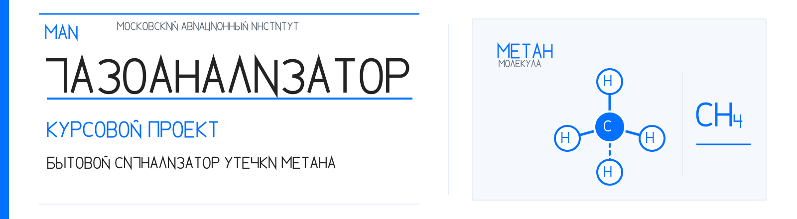

# Расчётно-пояснительная записка — рабочий комплект

  

  
  
  

**Проект:** бытовой сигнализатор утечки метана (CH₄).  
**Рабочая ветка:** `analysis/vendor-behavioral-reconciliation`.  
**Утверждённая электрическая база:** тег `gost-e3-approved-2026-11-01`, схема `cad/project_modification/gost_e3_final/gazo_analizator_E3_GOST_itog.kicad_sch`.  
**Статус:** содержательная разработка РПЗ. Не является выпуском документа в производство.

## Быстрая навигация по главам

| Глава | Содержание |
|---|---|
| 1 | [Введение и анализ проекта](01_intro_and_project_analysis.md) |
| 2 | [Технические требования](02_technical_requirements.md) |
| 3 | [Выбор элементной базы](03_component_selection.md) |
| 4 | [Электрические расчёты](04_electrical_calculations.md) |
| 5 | [Печатная плата и функциональная ячейка](05_pcb_and_functional_cell.md) |
| 6 | [Тепловой режим, графики и номограммы](06_thermal_model_and_sensitivity.md) |
| 7 | [Механическая прочность](07_mechanical_strength.md) |
| 8 | [Надёжность](08_reliability.md) |
| 9 | [Технологичность и изготовление](09_manufacturability_and_process.md) |
| 10 | [Заключение и открытые вопросы](10_conclusion_and_open_issues.md) |
| 11 | [Стандарты и источники](11_standards_and_references.md) |

**Тепловые иллюстрации:** [параметрическая характеристика](thermal_sensitivity.svg) · [номограмма естественной конвекции](natural_convection_nomogram.svg).
**Схема E3:** [функционально-связевое представление](../figures/e3_approved_topology.svg) · [полная карта сетей](../figures/e3_approved_netlist_map.md) · [нативный KiCad](../../cad/project_modification/gost_e3_final/gazo_analizator_E3_GOST_itog.kicad_sch).
**Основная галерея опубликованных иллюстраций:** [утверждённая E3 и два температурных графика](../figures/README.md) · [теги и статусы](../PROJECT_TAGS.md). Архивные SPICE- и исторические изображения остаются в исходных каталогах и не выдаются за текущие результаты.
**Генераторы:** [тепловая чувствительность](tools/thermal_sensitivity.py) · [номограмма Churchill–Chu](tools/natural_convection_nomogram.py).
**Единый стандарт Markdown и LaTeX:** [DOCUMENTATION_STYLE.md](../DOCUMENTATION_STYLE.md).
**Нормативные требования к итоговой РПЗ:** [контрольный лист](../../requirements/report_formatting.md).

## 1. Назначение этого каталога

Каталог содержит восстановимые промежуточные результаты подготовки РПЗ. Каждая законченная содержательная операция фиксируется отдельным коммитом в рабочей ветке. Основной текст хранится в Markdown как редактируемый источник. ODT/PDF формируются из зафиксированного текста и проверяются отдельно.

## 2. Пример и принцип адаптации

Пользовательский пример «Игровой автомат» (57 страниц) используется как образец структуры и инженерной глубины. В нём есть:
- анализ задания и принципиальной схемы;
- выбор и анализ элементной базы;
- требования к конструкции;
- выбор охлаждения и корпуса;
- проектирование функциональной ячейки и печатной платы;
- тепловой расчёт с номограммами и графиками (печатные страницы 31–37);
- оценка вибропрочности (стр. 38–40);
- расчёт надёжности (стр. 41–43);
- оценка технологичности и технология изготовления (стр. 44–52);
- заключение, приложения и источники.

Структура будет адаптирована к газосигнализатору. Чужие номиналы, результаты, требования, материалы и выводы из примера не переносятся. Номограммы и графики строятся только по методике и исходным данным, применимым к текущему изделию. Если исходных данных для численного результата нет, в записке будет расчётный метод, таблица недостающих исходных данных и честный статус «не определено/не подтверждено», а не фиктивный результат.

## 3. Структура РПЗ

1. Введение.
2. Анализ задания на курсовой проект.
   - Назначение и исходные данные.
   - Анализ исходного устройства и функциональная структура.
   - Конструктивно-технический анализ утверждённой Э3.
   - Принцип работы.
   - Условия эксплуатации и ограничения.
3. Техническое задание на разработку конструкции.
4. Выбор и анализ элементной базы.
   - Сенсорный модуль и интерфейс.
   - Таймер, транзистор, световая и звуковая сигнализация.
   - Пассивные компоненты, соединители и коммутация.
   - Сводная ведомость ЭРИ с подтверждёнными/неподтверждёнными корпусами.
5. Электрические расчёты и проверка режимов.
   - DOUT и VT1.
   - RESET и времязадающая цепь NE555.
   - Световая и звуковая ветви.
   - Баланс тока и мощности.
   - SPICE как отдельный расчётно-модельный источник, не физическое измерение.
6. Разработка функциональной ячейки и печатной платы.
7. Проектирование корпуса и компоновка изделия.
8. Тепловой режим и охлаждение.
9. Вибропрочность и механические воздействия.
10. Надёжность изделия.
11. Технологичность конструкции.
12. Технология изготовления, сборки и контроля.
13. Заключение.
14. Список использованных источников.
15. Приложения (чертежи, таблицы, карты, дополнительные расчёты и программа проверок).

Нумерация и названия будут уточняться после проверки методических указаний МАИ и окончательного набора реально подготовленных графических документов.

## 4. Приоритет источников

При расхождении используются следующие уровни:
1. утверждённая пользователем редакция Э3 и её XML-netlist — для состава и соединений;
2. точные документы изготовителей конкретных исполнений — для электрических и физических параметров;
3. исходная публикация 2022 года — для исходной идеи и контекста, но не как доказательство характеристик модифицированных компонентов;
4. рабочие расчёты и SPICE-материалы — только в пределах явно описанных моделей и допущений;
5. пример «Игровой автомат» — только для структуры, стиля инженерной проработки и видов расчётов.

## 5. Зафиксированные ограничения и конфликты

- Утверждённая Э3 имеет A1 = Joy-IT SEN-MQ4-V2, DA1 = NE555N, VT1 = КТ3102Б, C1 = 47 мкФ, R4 = R5 = 8,2 кОм и остальные номиналы согласно схеме.
- Пользователь подтвердил Joy-IT SEN-MQ4-V2, соответствующий A1 в утверждённой Э3. Ранний выбор Amperka AMP-B052 отменён и не применяется к текущей сборке. Основная плата сохраняет E3 без изменений. USB-C питание реализуется отдельной платой E4, выдающей +5 V/GND на XS1.
- Существующая предварительная PCB использует другую схемную ветку, включает U2, P1, RHYS, VT2 и не содержит трассировки. Она не считается физической реализацией утверждённой Э3.
- Для утверждённой Э3 footprints не назначены. 17 ERC warnings относятся к footprint_filter, один — к отдельному AOUT. ERC: 0 errors, 18 warnings.
- Вывод A1.3/AOUT оставлен отдельным измерительным выводом, а C3.2 и SA1.2 образуют отдельную сеть. Это зафиксировано в утверждённой редакции и не будет изменено в ходе подготовки текста.
- Порог 1000 ppm является проектной целью, но точность/калибровка конкретного модуля на этой концентрации не подтверждена.
- Условие предела потребления 300 мА происходит из исходной публикации. Полный максимальный ток SEN-MQ4-V2 и всей системы не доказан.
- Температура, влажность, степень защиты, вибрация, масса и габариты всего изделия требуют задания/согласования либо остаются ненормированными.
- Температурный режим, вибропрочность и полная надёжность нельзя объявлять подтверждёнными без утверждённых условий эксплуатации, данных о корпусе, монтаже и комплектных паспортов компонентов.

## 6. Правила вычислений, иллюстраций и номограмм

Каждый расчёт должен содержать:
- исходные величины и их источники;
- обозначения, размерности и диапазоны;
- расчётную модель и границы её применимости;
- формулу, подстановку и проверяемый численный результат;
- оценку погрешности/чувствительности там, где это существенно;
- инженерный вывод и статус результата.

Номограммы и графики должны иметь оси, единицы измерения, легенду, подпись, маркеры выбранной рабочей точки и пояснение, из какого уравнения/источника они получены. Не допускается визуально имитировать чтение номограммы, если исходная номограмма или методика не найдена. При возможности графики строятся воспроизводимым Python-скриптом и вместе с исходными таблицами коммитятся в репозиторий.

## 7. Контрольные точки и готовность РПЗ

| Контрольная точка | Статус | Пояснение |
|---|---|---|
| Утверждённая E3 и базовые ограничения | **PASS** | Электрическая база и её baseline сверены. Это не означает физические испытания |
| Анализ примера РПЗ «Игровой автомат» | **PASS** | Изучены структура и инженерные разделы, включая тепловые номограммы, вибрацию, надёжность и технологичность. Чужие исходные данные не переносятся |
| Сверка всех исходников и фактических CAD-артефактов | **PARTIAL** | Сверена значительная часть текущей базы, но PCB E3/E4 и итоговая CAD-сборка ещё отсутствуют |
| Единая техническая база без всех исторических расхождений | **PARTIAL** | Текущая E3/V2 отделена от V1/Amperka. Архивные документы маркируются, отдельные старые фрагменты ещё требуют ревизии |
| Текстовые главы | **PARTIAL** | Подготовлены 11 Markdown-глав. Их статусы различаются: рабочие редакции, предварительные расчёты и методики с ожидающими исходными данными |
| Воспроизводимые графики и номограммы | **PARTIAL** | Два тепловых графика имеют Python-генераторы. Часть исследовательских SPICE-графиков построена, несколько plotter-наборов ожидают исходных .dat |
| Контрольная сборка в ODT | **PARTIAL** | Контрольный ODT на 33 страницы существует по ссылке OneDrive. Перед итоговой выдачей его нужно синхронизировать с последними правками Markdown |
| Постраничная визуальная проверка PDF | **NOT COMPLETED** | Экспорт открывался без ошибок, но полный просмотр каждого листа, формул, рисунков и основной надписи не завершён |
| Финальная техническая и редакционная вычитка | **NOT COMPLETED** | Нужна после синхронизации глав, расчётов, таблиц, рисунков, ссылок и контрольной ODT/PDF-сборки |

Эта таблица описывает состояние именно РПЗ. Общие этапы разработки E3/E4, PCB и корпуса см. в [карте прогресса проекта](../project_progress_map.md).

## 8. Состав подготовленных глав

| Файл | Содержание | Статус |
|---|---|---|
| [01_intro_and_project_analysis.md](01_intro_and_project_analysis.md) | Введение, исходные данные, принцип действия, топология Э3 | Рабочая редакция |
| [02_technical_requirements.md](02_technical_requirements.md) | Проектные технические требования и программа приёмки | Рабочая редакция |
| [03_component_selection.md](03_component_selection.md) | Выбор элементной базы и расчёт генератора NE555 | Рабочая редакция |
| [04_electrical_calculations.md](04_electrical_calculations.md) | DOUT–VT1–RESET, нагрузочные режимы и электрические проверки | Рабочая редакция |
| [05_pcb_and_functional_cell.md](05_pcb_and_functional_cell.md) | Функциональная ячейка, сенсорная компоновка и PCB | Рабочая редакция |
| [06_thermal_model_and_sensitivity.md](06_thermal_model_and_sensitivity.md) | Тепловая модель МАИ и параметрическая характеристика | Предварительная оценка |
| [07_mechanical_strength.md](07_mechanical_strength.md) | Собственные частоты, прогиб платы и крепления | Методика, расчёт ожидает исходных данных |
| [08_reliability.md](08_reliability.md) | Последовательная модель надёжности и состав 19 позиций Э3 | Методика, расчёт ожидает исходных данных |
| [09_manufacturability_and_process.md](09_manufacturability_and_process.md) | Технологичность и маршрут единичного макета | Рабочая редакция |
| [10_conclusion_and_open_issues.md](10_conclusion_and_open_issues.md) | Заключение и перечень незакрытых вопросов | Рабочая редакция |
| [11_standards_and_references.md](11_standards_and_references.md) | Нормативная база и список источников | Проверено на 01.11.2026 |
| [thermal_sensitivity.svg](thermal_sensitivity.svg) | Иллюстративная параметрическая тепловая характеристика | Не является результатом измерений |
| [tools/thermal_sensitivity.py](tools/thermal_sensitivity.py) | Генератор графика тепловой чувствительности | Воспроизводимый исходник |
| [natural_convection_nomogram.svg](natural_convection_nomogram.svg) | Номограмма естественной конвекции по Churchill–Chu | Параметрический расчёт, не измерение |
| [tools/natural_convection_nomogram.py](tools/natural_convection_nomogram.py) | Генератор номограммы естественной конвекции | Воспроизводимый исходник |

## 9. Нормативная база

На 01.11.2026 ГОСТ Р 2.105-2019 значится действующим с учётом изменений и поправок. ГОСТ Р 2.105-2026 утверждён, но вводится 01.10.2027 с правом досрочного применения. Досрочное применение в данной редакции не принято. ГОСТ Р 2.301-2026 также вводится 01.10.2027. Статус и ссылки вынесены в [11_standards_and_references.md](11_standards_and_references.md).

## 10. Правило сборки и продолжения

Markdown-файлы в каталоге являются главным редактируемым источником содержания. Итоговый ODT должен формироваться из этого набора и шаблона пользователя. Ручная правка только ODT без обратного переноса в исходные главы не считается завершённым изменением. PDF используется для визуального контроля, а не как единственный редактируемый оригинал.

На каждом завершённом этапе фиксируется коммит в рабочей ветке. При продолжении работы сначала проверяется HEAD ветки и список файлов, затем изменение выполняется поверх актуального состояния. Утверждённая электрическая схема и тег `gost-e3-approved-2026-11-01` не меняются в рамках редактирования РПЗ.

## 11. История контрольных точек

- 2026-11-01 — создан рабочий план РПЗ, зафиксированы правила адаптации примера и известные конфликты исходных данных.

## Текущая конструктивная база

Пользовательские решения по двум слоям, mixed SMD/THT, Joy-IT SEN-MQ4-V2, настольному корпусу, USB 5 В и реальному изготовлению зафиксированы в [основании проектирования PCB и корпуса](../../cad/pcb_design_basis_2026-11-01.md). Реестр компонентов и footprints находится в [footprint register](../../cad/footprint_selection_2026-11-01.md). Отдельная плата USB-C E4 описана в [E4 requirements](../../cad/power_input_usb/README.md).

## Итоговый документ ODT

**Рабочая копия:** [RPZ_Gazoanalizator_MAI.odt в OneDrive](https://1drv.ms/w/c/24fda6920aa8c92a/IQBgvF5tTSGsRpjx8u47tfMPAWUgI9pUcU)  
**Папка OneDrive:** [gazo_analizator_RPZ](https://onedrive.live.com?cid=24FDA6920AA8C92A&id=24FDA6920AA8C92A!s5724f231f1254e0688d88cb2f00475b9)  
**Формат:** ODT, 76 069 байт.  
**Контрольная проверка:** файл открыт LibreOffice и экспортирован в PDF без ошибок, 33 страницы A4.  
**SHA-256 локального ODT:** `84b7ca30334d3e07d36fc698df13674bcdc7709859443e995ad3fdd7835c9419`.

Ссылка имеет доступ «по ссылке — просмотр». ODT является контрольной сборкой на основе шаблона МАИ. Редактируемые главы и расчётные исходники остаются в этом каталоге и должны обновляться вместе с каждой следующей сборкой.
