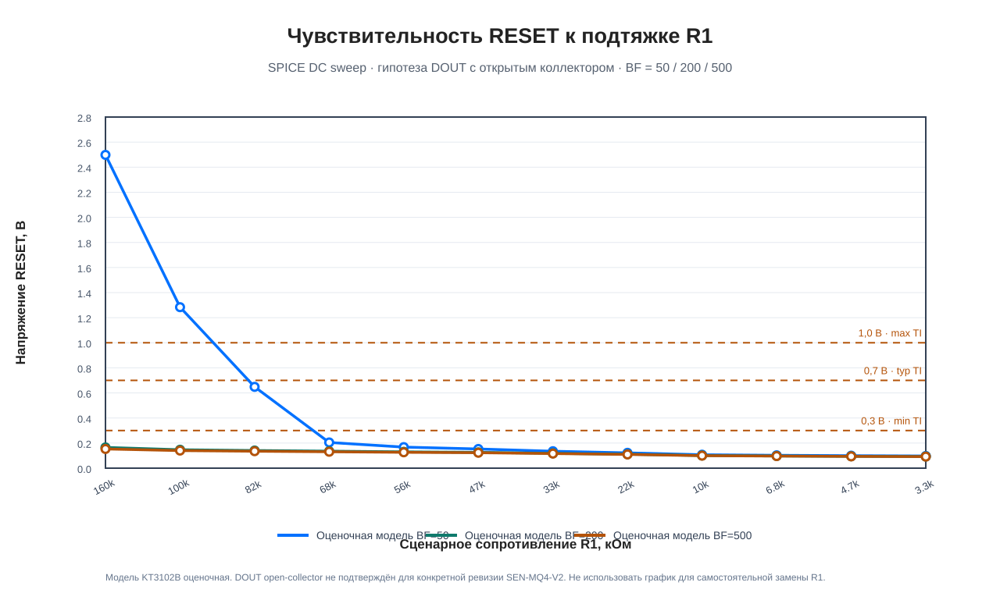
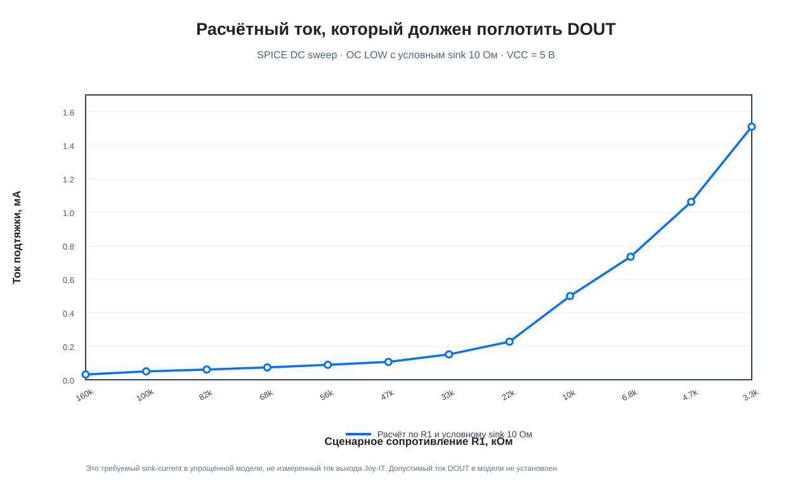
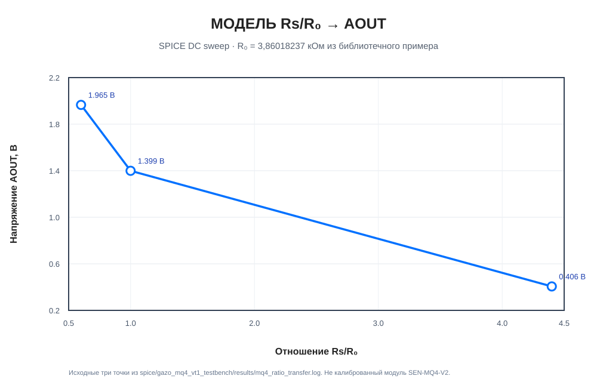

# Графики SPICE

**Категория:** SPICE MODEL / исследовательские расчётные материалы.  
**Назначение:** публиковать графики, построенные по сохранённым логам ngspice. Все кривые ниже относятся к упрощённым моделям, а не к измерениям сенсорного модуля.

## 1. Чувствительность входного каскада к R1

**Рисунок S.1 — Напряжение RESET при разных R1 и оценочном коэффициенте передачи BF.**

Источник: \`gazo_mq4_vt1_testbench/gazo_r1_pullup_sweep/results/r1_sweep_beta_*.log\`. Сценарии \`OC RELEASED\`, R2 = 13 кОм, R3 = 2 кОм, VCC = 5 В. Уровни 0,3/0,7/1,0 В показаны как минимальное/типовое/максимальное справочное значение RESET NE555 в условиях, указанных в документации TI.

**Ограничение:** открытый коллектор DOUT модуля SEN-MQ4-V2 не подтверждён документацией конкретной ревизии. BF = 50/200/500 — точки чувствительности оценочной модели КТ3102Б. График не является рекомендацией менять R1.

## 2. Расчётный ток, который должен поглотить DOUT

**Рисунок S.2 — Ток внешней подтяжки, который должен поглотить выход DOUT в сценарии OC LOW.**

Источник: те же логи R1 sweep. В модели активное состояние DOUT представлено условным сопротивлением 10 Ом. Допустимый sink-current реального модуля не задан и не выводится из этого графика.

## 3. Исследовательская модель MQ-4 Rs/R0 → AOUT

**Рисунок S.3 — Расчётная зависимость AOUT от отношения Rs/R0 в сценарной модели MQ-4.**

Источник: \`gazo_mq4_vt1_testbench/results/mq4_ratio_transfer.log\`. Для расчёта использован библиотечный пример R0 = 3,86018237 кОм. Три точки не являются калибровочной характеристикой Joy-IT SEN-MQ4-V2.

## Воспроизведение

Из корня репозитория:

\`\`\`fish
cd ~/projects/gazo_analizator
ngspice -b spice/gazo_mq4_vt1_testbench/mq4_ratio_transfer.cir
cd spice/gazo_mq4_vt1_testbench/gazo_r1_pullup_sweep
python3 run_r1_sweep.py
\`\`\`

Для корректного повторного построения SVG используйте сохранённые логи в каталоге \`results/\`. Скрипты расчёта и модели находятся рядом с ними. Эти графики не запускают CI и не требуют скачивания vendor-моделей.

## Другие графические SPICE-материалы

Исторические графики ранней архитектуры (Amperka AMP-B052, TLV7041-Q1, TLC555, VT2/R9) оставлены в [каталоге иллюстраций](../../docs/figures/README.md) под меткой HISTORICAL. Они не являются результатами моделирования утверждённой E3.

## 4. Графики, ожидающие исходные временные ряды

В репозитории также есть plotter-скрипты для других сценариев, но их исходные массивы .dat в текущей ветке не сохранены. Поэтому соответствующие выходные графики здесь не публикуются как будто они уже проверены:

| Скрипт | Требуемые данные | Ожидаемый график |
|---|---|---|
| spice/plot_bode.py | spice/bode_results.dat | spice/bode_linearized.png |
| spice/plot_model_comparison.py | spice/model_comparison_behavioral.dat, spice/model_comparison_vendor.dat | spice/model_comparison_overlay.png, spice/model_comparison_branch_currents.png |
| spice/plot_results.py | spice/spice_chain_results.dat | spice/spice_chain_plots.png |

Текстовый протокол spice/model_comparison_2026-10-25.md содержит численные результаты и ограничения сравнения, но не заменяет исходные временные ряды для восстановления графиков. После добавления исходных .dat эти графики нужно построить штатными скриптами и добавить в реестр с точными источниками.
